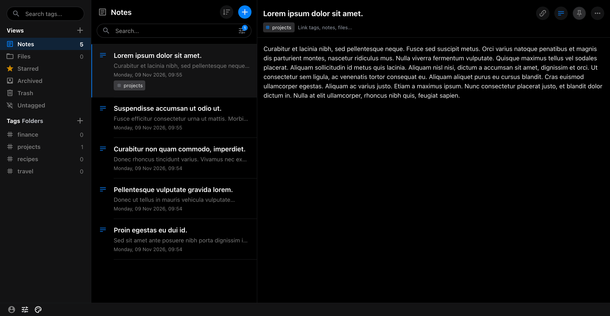

# Pure Black Theme for Standard Notes

A pure-black theme for [Standard Notes](https://standardnotes.com). Continuing the no longer
maintained [christianhans/sn-pure-black-theme](https://github.com/christianhans/sn-pure-black-theme).

## Preview



## Installation

1. Preferences → Plugins → Install Custom Plugin:

   ```
   https://sn-pure-black-theme.edbartholomew.workers.dev/ext.json
   ```

2. Open the quick settings menu and select "Pure Black".

## Development

See [docs/DEVELOPMENT.md](docs/DEVELOPMENT.md).

## License

[MIT](LICENSE)
